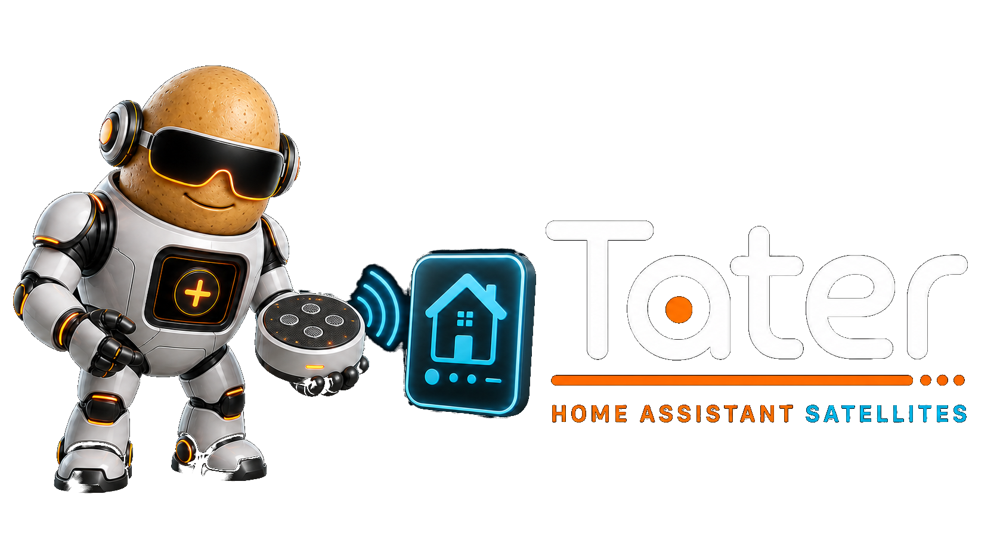

  

  
  

# Tater Home Assistant Satellites

Bring your Tater satellites into Home Assistant for voice control, timers,
announcements, and music. They connect directly to Home Assistant Assist, so
the Tater Assistant add-on is not required.

## What you can do

- **Voice:** use Assist, set timers, and play announcements.
- **Music:** play audio, save stereo pairs, and group speakers across rooms.
- **Calls and alerts:** broadcast intercom messages, make Sat Chat calls, and
  send camera alerts to compatible Echo screens or Home Assistant phones.
- **Personalize:** choose wake words and adjust each satellite's sound,
  display, and night settings.
- **Bluetooth:** discover and connect supported Bluetooth devices through a satellite.
- **Optional Tater mode:** use your own language and speech models for voice
  conversations, home control, camera questions, HA lists and weather, music,
  spoken announcements, and delayed device actions.

Available features depend on the satellite's hardware and firmware.

## Get started

### 1. Check the requirements

You need **Home Assistant 2026.6.0 or newer** and a satellite running compatible
Tater firmware:

- [Tater Native Firmware](https://github.com/TaterTotterson/Tater-Native-Firmware)
- [Tater Echo Firmware](https://github.com/TaterTotterson/Tater-Echo-Firmware)
- [Tater ThirdReality S420 Firmware](https://github.com/TaterTotterson/Tater-ThirdReality-Voice-Firmware)

For Home Assistant voice control, have a working Assist pipeline ready.

### 2. Install the integration

On **Home Assistant 2026.11 or newer**, use Marketplace:

1. Open **Settings → Marketplace → Add from link** and enter
   `https://github.com/TaterTotterson/Tater-Home-Assistant-Satellites`.
   Connect GitHub if prompted and choose **Integration** if asked.
2. Install **Tater Native Satellites**, then restart Home Assistant.
3. Open **Settings → Devices & services → Add integration**, search for
   **Tater Satellite**, and add it.

On **Home Assistant 2026.6–2026.10**, [add this repository to HACS](https://my.home-assistant.io/redirect/hacs_repository/?owner=TaterTotterson&repository=Tater-Home-Assistant-Satellites&category=integration)
as an **Integration**, then follow steps 2–3 above.
[Manual installation](docs/user-guide.md#manual-installation) is also available.

### 3. Pair your satellite

1. Open **Tater Satellites** in the Home Assistant sidebar.
2. Select **Add satellite** to get a temporary pairing code.
3. Put your satellite into setup mode. On its setup page, enter the
   **Home Assistant URL shown in the panel** and the **pairing code**.
4. Save and let the satellite reboot.

Once the satellite is online, try your wake word and a voice command.
It uses your preferred Assist pipeline by default; open the satellite's
**Voice** settings to choose a different one.

## Make it yours

Everything is managed from **Tater Satellites** in the sidebar:

- **Satellites:** open a device to change its name, room, volume, and settings.
- **Voice defaults:** choose a shared wake word and voice settings.
- **Tater Audio:** create stereo pairs and manage room playback.
- **Awareness / Vision:** set up camera alerts and image understanding.
- **Assistant:** keep Home Assistant Assist or configure optional Tater mode.

For Bluetooth, wake-word training, calls, and other options, see the
[user guide](docs/user-guide.md).

## Updates and recovery

Update the integration from **Settings → Updates** (or HACS on older versions),
then restart Home Assistant. Update satellite firmware from
**Tater Satellites → Firmware & recovery**.

Echo devices moving from v4.2.3 to the new hardware platform need a one-time
full USB factory upgrade before wireless updates can resume. See
[firmware and recovery instructions](docs/user-guide.md#firmware-updates-and-recovery)
for hardware-specific steps.

## More help

- [User guide](docs/user-guide.md) — detailed setup and feature instructions
- [Release notes](RELEASE_NOTES.md) and [changelog](CHANGELOG.md)
- [Report a problem](https://github.com/TaterTotterson/Tater-Home-Assistant-Satellites/issues)

## Related projects

- [Tater Native Firmware](https://github.com/TaterTotterson/Tater-Native-Firmware)
- [Tater Echo Firmware](https://github.com/TaterTotterson/Tater-Echo-Firmware)
- [Tater ThirdReality Voice Firmware](https://github.com/TaterTotterson/Tater-ThirdReality-Voice-Firmware)
- [Tater Assistant](https://github.com/TaterTotterson/Tater)
- [Tater Home Assistant Add-ons](https://github.com/TaterTotterson/hassio-addons-tater)

Licensed under [GNU AGPL v3](LICENSE). The name and logo are covered by the
[Tater Trademark Policy](TRADEMARKS.md).
